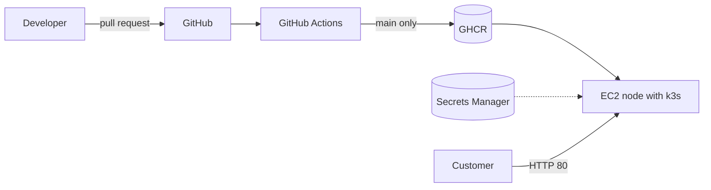

# Zuri Market DevOps Capstone

10Alytics DevOps capstone: taking the Zuri Market store (a Node/Express API and a
React/Vite frontend) from "push to main and hope" to a tested, scanned, monitored
deployment on AWS, built entirely from code.

## 1. Overview: the four problems Zuri had

| Problem | What we built to fix it |
|---|---|
| Everyone pushed straight to `main`, so broken code reached customers | Protected `main`: pull requests only, no force pushes, and four required CI checks |
| A bad release caused a six-hour outage with no quick way back | Image tags pinned to commits, rolling updates with `maxUnavailable: 0`, and a practised `kubectl rollout undo` |
| Nobody knew who had SSH access, and secrets lived in Git | No SSH and no key pair (SSM Session Manager only); the API key lives in AWS Secrets Manager |
| Problems were only found by reading pm2 logs after customers complained | Prometheus and a Grafana dashboard (traffic, errors, latency), plus a daily health check |

## 2. Architecture

See [docs/architecture.md](docs/architecture.md) for the full diagram and request flow.



**Key decisions**

- **One EC2 node running k3s** instead of EKS: EKS costs about US$0.10/hour for the control
  plane alone. k3s ships with the Traefik Ingress controller.
- **Public subnet, no NAT gateway:** the node needs inbound port 80 and outbound image pulls;
  a NAT gateway would add about US$30/month. Only port 80 is open.
- **Remote Terraform state in S3** with versioning, encryption, HTTPS-only access and native locking.

## 3. Repository structure

```
backend/        Express API, Dockerfile, ESLint, tests, sonar-project.properties
frontend/       React/Vite app, Dockerfile (nginx), Vitest, sonar-project.properties
terraform/      bootstrap/ (state bucket), modules/ (network, security, compute, secrets),
                environments/dev and environments/prod
k8s/            namespace, RBAC, Ingress, backend/ and frontend/ manifests, ServiceMonitor
monitoring/     dashboards/zuri-overview.json (Grafana)
scripts/        sync-secrets.sh, set-image.sh, health-check.sh
docs/           architecture.md, jenkins-vs-github-actions.md
.github/        backend-ci.yml, frontend-ci.yml, dependabot.yml
docker-compose.yml
```

**Starter code credit:** the applications come from
[Test-class2026/zuriapp-backend](https://github.com/Test-class2026/zuriapp-backend) and
[Test-class2026/zuriapp-frontend](https://github.com/Test-class2026/zuriapp-frontend),
imported as folders.

**What the apps really use** (checked in the code):

| Setting | Value |
|---|---|
| Backend port | `PORT`, default 5000 |
| Backend variables | `PORT`, `STORE_NAME` (config), `API_SECRET_KEY` (secret) |
| API routes | `GET /api/health`, `/api/store`, `/api/products`, `/api/products/:id`; `POST /api/cart/validate` (needs `x-api-key`); `GET /metrics` |
| Frontend variables | `VITE_API_URL`, `VITE_STORE_NAME` (baked in at build time) |
| Node version | 22 (`.nvmrc` in both apps) |

## 4. Run locally (Docker Compose)

```bash
cp backend/.env.example backend/.env    # then set API_SECRET_KEY
docker compose up --build -d
```

- Frontend: http://localhost:8080 (nginx proxies `/api` to the backend)
- Backend: http://localhost:5002/api/health (port 5002 on the Mac, because macOS AirPlay uses 5000)
- Stop: `docker compose down`

Without Docker: `npm install` and `npm start` in `backend/`, `npm run dev` in `frontend/`.

## 5. Run in the cloud (Terraform, then Kubernetes)

Prerequisites: AWS CLI signed in (never as root), Terraform 1.11+, the Session Manager plugin.

```bash
# once: the state bucket
cd terraform/bootstrap
terraform init && terraform apply -var="region=eu-west-1" -var="bucket_name=<unique-name>"

# the dev environment
cd ../environments/dev
terraform init
terraform plan -var-file=dev.tfvars -out=dev.plan
terraform apply dev.plan

# store the API key (value never enters Terraform or Git)
aws secretsmanager put-secret-value --secret-id zuri/dev/backend --secret-string file://secret.json

# open a shell on the node (no SSH)
aws ssm start-session --target "$(terraform output -raw instance_id)"
```

On the node (`sudo -i`):

```bash
git clone https://github.com/Mmeso1/zuri-market-capstone.git /opt/zuri/zuri-market-capstone
cd /opt/zuri/zuri-market-capstone
kubectl apply -f k8s/namespace.yaml
kubectl apply -f k8s/rbac.yaml
./scripts/sync-secrets.sh dev
kubectl apply -f k8s/backend/ -f k8s/frontend/ -f k8s/ingress.yaml
kubectl -n zuri-market rollout status deployment/backend
```

`prod` uses the same modules with `prod.tfvars` (smaller instance, separate VPC range and
state key). It was applied once for evidence and then destroyed.

## 6. CI/CD

Each app has its own workflow. Both run on every pull request; on `main` they run only
when their folder changes (so merging a `k8s/` tag bump does not rebuild images in a loop).

| Step | Why |
|---|---|
| `npm ci`, lint, test | Cheap checks first; broken code fails in seconds |
| `npm audit --audit-level=high` | Blocks known-vulnerable dependencies |
| SonarQube quality gate | Blocks bugs, security hotspots and code smells in new code |
| Docker build, then Trivy scan | Blocks HIGH/CRITICAL vulnerabilities in the image |
| Push to GHCR (`main` only) | Images tagged `sha-<commit>` (and `latest`); manifests use only the `sha-` tag |

- Third-party actions (SonarQube, Trivy) are pinned to full commit SHAs, after the
  March 2026 Trivy action compromise; Dependabot proposes updates.
- The default workflow token is read-only; only the image job gets `packages: write`.
- **The pipeline fails when it should:** the first pull request was blocked by Trivy
  (npm bundled in the Node image, outdated Alpine packages in nginx). Both were fixed,
  not ignored.

## 7. Security

- **Secrets:** CLI → AWS Secrets Manager (`zuri/<env>/backend`) → read by the node's IAM
  role → `sync-secrets.sh` → Kubernetes Secret `backend-secrets` → `envFrom` → process
  environment. No secret in Git, a Dockerfile or a manifest.
- **Network:** security group allows inbound port 80 only. No SSH, no key pair.
- **IAM:** the node role has SSM access and `GetSecretValue` on its own secret only.
- **Node:** IMDSv2 required, encrypted gp3 disk.
- **Containers:** non-root users, no privilege escalation, all Linux capabilities dropped,
  read-only root filesystem for the backend, `npm ci --ignore-scripts`.
- **Kubernetes RBAC:** `ci-deployer` can update deployments but cannot delete pods or read
  secrets (proved with `kubectl auth can-i`). App pods get no API token.
- **Scans:** SonarQube findings were fixed (ignore-scripts, CORS restricted, `X-Powered-By`
  disabled, HTTPS-only state bucket) or accepted with a written reason (public IP on the node,
  no access logging on the state bucket).
- **Known limit:** Kubernetes Secrets are base64-encoded, not encrypted, unless k3s runs with
  `--secrets-encryption`.

## 8. Monitoring

- `kube-prometheus-stack` installed with Helm in the `monitoring` namespace; Grafana uses a
  random admin password from a Kubernetes Secret.
- A ServiceMonitor scrapes the backend's `/metrics` every 15 seconds.
- Grafana is not exposed to the internet; it is reached through an SSM port-forwarding tunnel.
- Dashboard **Zuri Overview** ([JSON](monitoring/dashboards/zuri-overview.json)):
  request rate, error rate, p95 latency, pod restarts.

## 9. Health check and cron

`scripts/health-check.sh` checks the frontend (`/`) and backend (`/api/health`) and appends
one line per run to `/var/log/zuri/health-report.txt`:

```
2026-10-31 06:00:01 UTC | HEALTHY | frontend=OK(200) | backend=OK(200)
```

Scheduled in `/etc/cron.d/zuri-health` for 06:00 UTC daily. It uses `>>` (append), so each
day adds a line instead of overwriting, and it exits non-zero when unhealthy so cron logs the failure.

## 10. Jenkins vs GitHub Actions

See [docs/jenkins-vs-github-actions.md](docs/jenkins-vs-github-actions.md).

## 11. Troubleshooting log

| Symptom | Cause | Fix |
|---|---|---|
| `EADDRINUSE :::5000` locally | macOS AirPlay Receiver uses port 5000 | Run on another port locally (5001/5002); containers still use 5000 |
| `npm install` ERESOLVE for ESLint | `eslint-plugin-react` does not support ESLint 10 yet | Pinned `eslint@9` and `@eslint/js@9` |
| Deployed frontend would call `localhost` | `VITE_API_URL \|\| fallback` treats an empty string as missing | Changed `\|\|` to `??` so the empty build value means relative `/api` |
| Compose: `host not found in upstream "backend"` | Backend container created during a failed port bind, without its network | `docker compose down` then `up` |
| `secret.json` not sent to AWS | Commands run in different folders | Ran from the home folder; verified with `describe-secret` |
| Terraform: `No configuration files` / missing `dev.tfvars` | Wrong working directory | `cd` to the right environment folder first |
| SonarQube step failed on `main` only | First analysis of `main` had no New Code definition | Set New Code to 30 days per project |
| Trivy blocked both images | npm bundled in the Node image; outdated Alpine packages | Removed npm/Yarn from the runtime image; `apk upgrade` at build time |
| `kubectl` "connection refused" | Command ran on the Mac instead of the node | Run cluster commands in the SSM session |
| `rollout status` never finished | Deliberate broken image in the rollback drill | Expected; `rollout undo`, then `kubectl apply` from Git |

## 12. Evidence and one thing I would do differently

Evidence (screenshots) covers: the ruleset and merged pull requests; Terraform plan/apply,
module folders and the state file in S3; Docker images and Compose; a green and a red
pipeline run, SonarQube and Trivy output, images in GHCR; `kubectl get pods,svc,ingress`,
the `can-i` results and the rollback drill; the Grafana dashboard with data; Secrets Manager
(names only), the security group without SSH and the scoped IAM role; the cron file and the
health report.

**One thing I would do differently:** put a domain and HTTPS in front with an Application
Load Balancer, and move the node into the private subnet behind a NAT gateway. I would also
automate image promotion (a CI job that opens the tag-bump pull request) instead of bumping
tags by hand.
