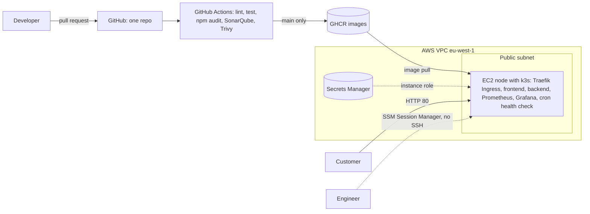

# Architecture

## How a request reaches the app

1. The customer's browser calls `http://<node-ip>/` on port 80, the only open port.
2. Traefik (the k3s Ingress controller) sends `/api/*` to the `backend` Service and
   everything else to the `frontend` Service.
3. Each Service load-balances across two pods.
4. `/metrics` is not routed by the Ingress, so only Prometheus inside the cluster can read it.

## How a code change reaches production

1. A pull request runs both pipelines: lint, test, `npm audit`, SonarQube quality gate,
   image build and Trivy scan. All four jobs are required before merge.
2. Merging to `main` rebuilds the changed app and pushes `ghcr.io/mmeso1/zuri-market-capstone-<app>:sha-<commit>`.
3. `scripts/set-image.sh` bumps the tag in `k8s/<app>/deployment.yaml` through a reviewed pull request.
4. On the node, `kubectl apply -f k8s/<app>/` rolls out the new pods with zero downtime
   (`maxUnavailable: 0`).
